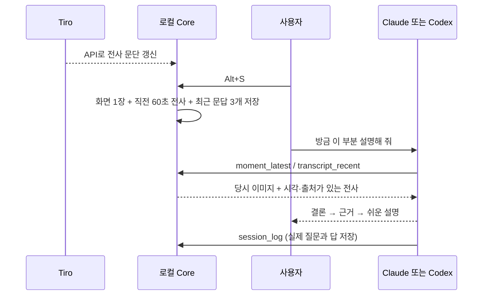

# classmate-core — Classmate Core (v0.3 · 1단계 진행 중)

수업 중 **지금 화면 + 방금 들은 말**을 붙잡아 순정 Claude / Codex 앱에 건네는 Windows 상주 프로그램입니다.
정본은 [kickoff](../../docs/kickoff-v0.3.md), 실행 계획은 [인수인계](../../docs/plan/core-mvp-handoff.md)입니다. **구현 (1)~(6)과 자동 시험 완료, 실제 수업 관문은 대기**입니다. 공개 ZIP 배포판·설치된 확장 0.1.6을 대체하지 않습니다. Core exe 버전 0.1.0은 제품 설계 v0.3 및 확장 버전과 별개입니다.

## 1. 한 exe, 네 진입점

| 명령 | 하는 일 | 상태 |
|---|---|---|
| `classmate-core` | 트레이 상주 데몬 — Tiro 폴링 · 변화 감지 타임라인 · Alt+S · 보존 정리 · heartbeat | 있음 (4) |
| `classmate-core mcp` | stdio MCP 서버(앱마다 하나) — 툴 7개 · 데몬 자동 시작 | 있음 (5) |
| `classmate-core setup --key-file <경로>` | 파일의 키(`keyId.secret`)를 검사 → `/workspaces/me` 확인 → 자격 증명 관리자 저장 | 있음 (3) |
| `classmate-core setup --check` | 저장된 키로 워크스페이스 · 노트 · 문단 수 확인(비밀값 · 본문 없음) | 있음 (3) |
| `classmate-core setup --delete-key` | 저장된 키 지우기 | 있음 (3) |
| `classmate-core setup` | 숨김 콘솔 키 입력 · API 검증 · 캡처 설정 | 있음 (6) |
| `classmate-core setup --capture` | 키를 바꾸지 않고 창·영역·연속 캡처·묶음 이름 설정 | 있음 (6) |
| `classmate-core setup --claude-desktop` | Desktop 설정 탐색·백업·Classmate만 병합 | 있음 (6) |
| `classmate-core doctor` / `doctor --json` | 키 존재·과거 연결·데몬·노트·건수 진단 (자료 수정·API 호출 없음) | 있음 (6) |

1단계는 **이미지·전사를 AI에 전달하는 도구**입니다. 별도 전사 패널, 문단 클릭 UI, Send to AI, 다이어그램 렌더러, 블로그 자동 발행은 아직 없습니다. Claude/Codex 앱이 추론하고, Core는 모델 API나 구독 로그인 대행을 하지 않습니다.

## 처음 사용하는 순서 (개발 시험판)

Windows PC에 저장소와 Rust 툴체인을 준비한 뒤, **저장소 루트에서 별도 PowerShell 창**을 열어 실행합니다. 실행 파일을 PATH에 설치하는 과정은 아직 없으므로 아래처럼 `$coreExe`를 사용하세요.

```powershell
cargo build --release --manifest-path apps/core/Cargo.toml
$coreExe = (Resolve-Path '.\apps\core\target\release\classmate-core.exe').Path
& $coreExe setup
```

1. Tiro 공식 API 키를 **콘솔에만** 붙여넣고 Enter. 글자는 보이지 않습니다. `keyId.secret` 형식과 실제 API를 검증한 뒤 Windows 자격 증명 관리자에 저장합니다. 실패하면 기존 키를 유지합니다. Ctrl+C 또는 Esc로 취소할 수 있고, 이미 키가 있으면 빈 Enter로 유지·검증합니다. **키를 AI 채팅·.mcp.json·Git에 넣지 마세요.** 파이프/리디렉션된 `setup` 입력은 거절됩니다.
2. 이어지는 캡처 설정: 제목 규칙(기본 Chrome), 창이 없을 때 1=주 모니터 왼쪽 절반/2=전체, 창 내부 영역 `x,y,width,height` 또는 `none`, 연속 캡처 `y/n`, 공부 묶음 이름. 빈 Enter는 현재 값을 유지합니다. 묶음 이름만 바꾸며 기존 문답을 지우거나 새 교시로 나누지 않습니다.
3. 지금 Tiro의 내 워크스페이스에 공부할 노트가 있는지 확인합니다. **API 인증 성공과 노트 접근 성공은 별개**입니다. `setup --check`가 0개라고 하면 녹음 중단 때문이라고 단정하지 말고 계정·워크스페이스·API 키의 접근 범위를 확인하세요. 키를 바꿔야 하면 다시 `setup`을 사용합니다.
4. 아래 Claude Desktop 또는 Claude Code 경로 **하나**를 연결합니다. MCP 연결 초기화가 Core 데몬을 창 없이 시작합니다. 처음 연결부터 캡처가 시작될 수 있으므로 수업 창만 배치하고 사적인 창은 치우세요. 자동 수집이 싫으면 먼저 `setup --capture`에서 연속 캡처를 `n`으로 끄세요.
5. Tiro에서 실시간 녹음을 시작하고 `doctor` 문단 수가 늘어나는지 확인합니다. PC 강의는 Tiro 시스템 사운드, 현장 강의는 휴대폰 Tiro를 쓸 수 있습니다. **같은 API 키가 접근 가능한 워크스페이스의 노트**여야 하며 현재 Core는 공유 URL을 입력받는 확장 방식이 아닙니다.
6. 영상/판서를 보다가 **Alt+S → Claude/Codex에 질문**합니다. Alt+S 자체는 질문을 자동 전송하지 않습니다. 앱이 도구 승인을 요청하면 자료 범위를 확인하고 승인하세요.

### Claude Desktop Chat 연결

```powershell
& $coreExe setup --claude-desktop
```

기본 `%APPDATA%\Claude\claude_desktop_config.json`과 Windows 패키지 `Claude_*\LocalCache\Roaming\Claude`를 탐색합니다. 다른 `Claude-3p` 프로필은 자동으로 고치지 않습니다. 파일이 없으면 **Claude Desktop → Settings → Developer → Edit Config**로 한 번 만들어 주세요. 후보가 여러 개면 실제 앱에서 열린 파일을 명시합니다.

```powershell
& $coreExe setup --claude-desktop --config-file 'C:\실제\폴더\claude_desktop_config.json'
```

- 기존 다른 MCP·preferences는 보존합니다. 원본 바이트를 같은 폴더의 `claude_desktop_config.json.classmate-<시각>-<PID>.bak`에 백업합니다. 백업에 기존 인증 설정이 포함될 수 있으므로 공유하거나 Git에 넣지 마세요.
- 손상된 JSON·객체가 아닌 설정·다른 `classmate` 항목은 덮어쓰지 않습니다. 경로를 옮긴 Core로 기존 classmate만 교체하려면 위 명령 끝에 `--replace-classmate`를 명시합니다. 반복 실행 시 같은 연결이면 아무 파일도 바꾸지 않습니다.
- 실행한 exe의 **절대 경로**를 기록하므로 이후 exe를 다른 폴더로 옮기면 이 명령을 다시 실행해야 합니다.
- 저장 후 Claude Desktop을 **완전히 종료하고 다시 실행**해 Chat에서 `classmate`의 7개 도구를 확인하세요. 설치 명령은 앱을 강제 종료하지 않습니다. [공식 로컬 MCP 연결 안내](https://modelcontextprotocol.io/docs/develop/connect-local-servers).

### Codex 로컬 연결 (선택)

```powershell
codex mcp add classmate -- $coreExe mcp
codex mcp get classmate
```

새 로컬 세션에서 연결을 확인합니다. 위 명령 형식은 설치된 CLI 도움말과 [OpenAI MCP 공식 문서](https://developers.openai.com/codex/mcp)를 대조했습니다. **이 PC의 실제 Codex 이미지 답변·문답 저장까지 검증했다는 의미는 아닙니다.** 원격 Linux 서버에서는 이 Windows exe를 실행할 수 없습니다. 이번 작업은 ChatGPT 웹용 연결·공개 터널을 만들지 않습니다.

### 어떤 자료로 답하나요?



- “방금 이게 뭐야?”: 최근 순간을 확인합니다. 너무 오래된 순간은 현재 화면인 척 사용하지 않습니다.
- “지금 화면을 다시 봐 줘”: 필요하면 `moment_capture`로 현재 설정된 창을 새로 찍습니다.
- “그럼 생성자는 왜 필요해?”: 앞 질문의 같은 순간·문답으로 이어 설명합니다. 일반 개념 질문에는 불필요한 화면 캡처를 하지 않도록 지침을 제공합니다.
- 새 채팅: `session_summary`가 최근 문답 원문을 전달하고, 요약·핵심 용어 설명은 AI가 만듭니다. Core 안에 별도 요약 모델은 없습니다.
- **저장은 `session_log`가 성공한 답만**입니다. 모델 호출이 정책상 보장되는 것은 아니므로 처음에는 “방금 질문·답이 저장됐는지 확인해 줘”로 점검하세요. 녹음·화면 속 문장을 실행 지시로 따르지 않도록 스킬에 규정했습니다.

화면·전사는 먼저 PC의 Core 저장소에 남습니다. AI가 도구를 호출하면 **그 결과로 반환한 이미지·전사·문답은 사용 중인 Claude/OpenAI 서비스로 전달될 수 있습니다.** 모두 오프라인이라고 이해하면 안 됩니다. 수업/회의 녹음 동의 및 자료 공유 권한을 확인하세요.

### 멈춤·문제 점검

```powershell
& $coreExe doctor              # 자료를 바꾸지 않는 현재/과거 상태 구분
& $coreExe setup --check       # 실제 Tiro API 인증·노트·문단 수
& $coreExe setup --capture     # 키를 유지하고 설정만 수정
```

| 상황 | 확인할 것 |
|---|---|
| 키는 저장됨, 노트는 0개 | 키의 워크스페이스/범위와 Tiro 내 노트를 대조. 키를 채팅에 보내지 않음 |
| `daemon: stale` + `tiroState: connected` | connected는 과거 기록. 데몬을 시작한 뒤 마지막 문단 시각·건수 확인 |
| Alt+S가 안 됨 | `doctor`의 hotkey 등록 상태. 기존 확장과 충돌 가능; 임의로 기존 확장을 수정하지 않음 |
| 엉뚱한 화면/검은 화면 | 창 제목 규칙·최소화·가림 상태·영역 확인. GDI 실패 시 화면 영역을 찍으므로 캡처 이미지 직접 확인 |
| 설정을 바꿨는데 그대로 | Core 트레이 종료 → 앱의 MCP 연결/앱 재시작. 기존 브리지는 설정을 시작할 때 읽음 |
| 연결이 안 보임 | Desktop 설정 위치·JSON·exe 이동 여부·앱 완전 재시작 확인 |

Core 트레이에서 연속 캡처 켬/끔을 고르면 설정에도 저장됩니다. **연속 캡처 끄기는 Tiro 폴링까지 끄는 기능이 아닙니다.** 수집을 멈추려면 트레이 → 종료. MCP 앱이 새 연결을 초기화하면 데몬이 다시 시작할 수 있으므로 계속 쉬려면 앱의 Classmate 연결도 끄세요.

### MCP 연결과 자동 시험

저장소 루트 `.mcp.json`은 기존 Tiro 항목을 보존하고 `classmate`를 추가합니다. 먼저 `cargo build --release --manifest-path apps/core/Cargo.toml`로 실행 파일을 만들고 Claude Code를 이 저장소에서 새로 시작해 MCP 연결을 승인합니다. 초기화 응답이 스킬과 같은 학습 지침을 제공합니다. `/classmate:classmate`를 명시적으로 쓸 때는 `claude --plugin-dir ./plugins/classmate`로 이 저장소 안 플러그인을 로드합니다. 이 플러그인은 아직 마켓플레이스 독립 설치용이 아닙니다.

`node apps/core/scripts/mcp-roundtrip.mjs`는 debug exe를 실제로 실행해 7개 도구·이미지·출력 계약·SQLite 재시작 복원을 검사합니다. 임시 DB, 합성 문단, 16px 캡처를 쓰고 `mcp --no-daemon`으로 Tiro/상주 수집을 시작하지 않습니다. 마지막 인자로 release exe를 주어 동일 검사할 수 있습니다. 테스트 임시 자료는 OS 임시 폴더에 남고 실제 학습 폴더는 읽지 않습니다.

### 데몬 띄우기

```powershell
classmate-core            # 콘솔에 로그가 남는다. 트레이 아이콘 오른쪽 클릭 → 상태 · 지금 붙잡기 · 연속 캡처 · 설정 확인 · 데이터 폴더 · 종료
# Alt+S = 지금 화면 + 직전 60초 전사 + 최근 문답 3개 → moments · 트레이 풍선 "붙잡았어요"
# 종료: 트레이 메뉴 "종료" 또는 콘솔 Ctrl+C. 두 번째 실행은 "이미 실행 중" 으로 바로 끝난다.
```

타임라인은 `timeline.enabled`(기본 켬)일 때 약 1초마다 찍어 dHash 가 `timeline.dhash_threshold`(10/64) 이상 다른 장면만 남깁니다. 찍는 대상은 제목에 `capture.window_title_contains`("Chrome")가 든 가장 큰 창, 없으면 `capture.fallback`("left-half")입니다.

### Tiro 키 넣기

```powershell
# 키를 한 줄로 담은 파일을 만들고(예: 바탕 화면), 별도 PowerShell 창에서:
classmate-core setup --key-file "$env:USERPROFILE\Desktop\tiro-api.txt"
classmate-core setup --check          # 워크스페이스 이름 · 노트 수 · 문단 수
# 저장이 끝나면 키 파일은 지웁니다. 키를 채팅에 붙이지 않습니다.
```

응답 모양이 실측과 다를 때는 `CLASSMATE_TIRO_TRACE=1` 을 켜면 상태 · 경로 · 최상위 열쇠 · 배열 길이만 stderr 로 찍힙니다(본문 · 키 없음).

## 2. 자리

```
%LOCALAPPDATA%\CorthexClassmate\core\        ← 시험용 환경 변수 CLASSMATE_CORE_DIR
├─ core.sqlite                               ← paragraphs · frames · moments · qa_log · segments · status (WAL · busy_timeout 5초)
├─ config.json                               ← 사람이 고쳐도 되는 설정. Tiro 키는 여기 없다
└─ frames\<묶음 id>\fr-<epoch ms>.(webp|jpg|png)
```

- 호스트 0.1.6 의 `sessions\` 와는 다른 폴더입니다(DECISIONS 2026-09-10 (2)·(3)). 그쪽은 읽지도 쓰지도 않습니다.
- Tiro 키는 Windows 자격 증명 관리자(`CorthexClassmate` / `tiro`)에만 둡니다. 채팅에 붙이지 않습니다.
- 오류 문구 · 응답 · 표에 절대 경로(사용자 이름)와 키를 담지 않습니다.

## 3. 소스 지도

```
src/main.rs        진입점 분기(인자 없음 · mcp · setup · doctor · --version)
src/lib.rs         모듈 목록
src/paths.rs       데이터 폴더 · 파일 자리
src/config.rs      config.json (deny_unknown_fields · 없는 칸은 기본값)
src/clock.rs       RFC3339 ↔ epoch ms (native-host 것을 그대로 복사)
src/error.rs       CoreError (경로 · 키 없는 문구)
src/store/         SQLite: mod(열기 · 묶음 · status) · paragraphs · frames(파일 + 보존 정리) · moments · qa
src/tiro/          http(WinHTTP GET) · client(/workspaces · /notes · /paragraphs) · poller(노트 추적 · upsert) · credential(CredRead/WriteW) · fake(시험용 HTTP 스텁)
src/capture/       window(창 찾기 · 폴백 영역) · gdi(PrintWindow → BitBlt) · dhash · encode(WebP→JPEG) · moment(순간 묶기)
src/daemon/        mod(메시지 루프 · 창 프로시저) · single_instance(뮤텍스) · hotkey · tray(Shell_NotifyIconW) · timeline(스레드) · poll(스레드)
src/mcp/           (5) JSON-RPC stdio
src/setup.rs       대화형 키 · --capture · --check · --delete-key · --claude-desktop
src/setup/         console(숨김 입력) · desktop(설정 탐색·백업·병합)
src/doctor.rs      비파괴 진단 · JSON 출력 · 오래된 연결 구분
scripts/           mcp-roundtrip.mjs · setup-doctor-smoke.mjs
```

계약은 `packages/contracts/schemas/core-*.schema.json` 이 정본이고, 저장소 시험이 enum · 툴 이름을 그 JSON 과 맞댑니다.

## 4. 빌드 · 시험

이 크레이트는 `apps/native-host` 와 **다른** Cargo 워크스페이스입니다(`[workspace]` 빈 표). 루트에서:

```bash
cargo build --manifest-path apps/core/Cargo.toml
cargo test  --manifest-path apps/core/Cargo.toml
cargo clippy --manifest-path apps/core/Cargo.toml --all-targets -- -D warnings
cargo fmt   --manifest-path apps/core/Cargo.toml -- --check
node apps/core/scripts/mcp-roundtrip.mjs
node apps/core/scripts/setup-doctor-smoke.mjs
```

`pnpm test` 의 `cargo-core` 갈래가 같은 시험을 돌립니다.

2026-09-10 자동 확인: Rust 92개, clippy 경고 0, release 빌드, 7개 MCP 도구의 실행·JSON Schema·이미지·DB 재시작 복원, setup/doctor CLI의 임시 설정 병합·백업·잘못된 입력 보존. 키 숨김의 물리 콘솔 조작, 실제 Tiro 녹음 증가, 실제 강의 캡처 내용, Claude Code/Desktop 모델의 도구 선택은 별도 사용자 관문입니다. API 재확인은 인증 성공·노트 0개였으며 미해결 상태를 감추지 않습니다.

### 의존성 규칙 (DECISIONS 2026-09-10 (4))

이 PC 의 툴체인은 `stable-x86_64-pc-windows-gnu` 에 C 컴파일러 · 어셈블러가 없습니다. `raw-dylib` 을 쓰는
`windows-sys 0.61+` · `windows 0.6x` 갈래는 링크되지 않으므로(rustc 가 `dlltool` 을 부르는데 `as` 가 없어 실패)
**tokio · rmcp · reqwest · keyring · rpassword 를 쓰지 않습니다.** 대신:

| 필요 | 쓰는 것 |
|---|---|
| SQLite | `rusqlite =0.30.0` + `winsqlite3`(`build.rs` 가 `System32\winsqlite3.dll` 복사 · native-host 와 같음) |
| 이미지 | `image 0.25` (webp · jpeg · png · 순수 Rust) |
| Win32 | `windows 0.58` (windows-targets 0.52 · 미리 만든 import lib) |
| HTTPS · 자격 증명 · 콘솔 · 트레이 · 단축키 · 캡처 | `windows 0.58` 의 WinHTTP · CredRead/WriteW · SetConsoleMode · Shell_NotifyIconW · RegisterHotKey · GDI |
| MCP | 손으로 쓴 JSON-RPC 2.0 stdio(줄 단위) |

새 의존성을 더할 때는 `cargo tree -i windows-sys` 로 0.61 이상이 들어오지 않는지 봅니다.
