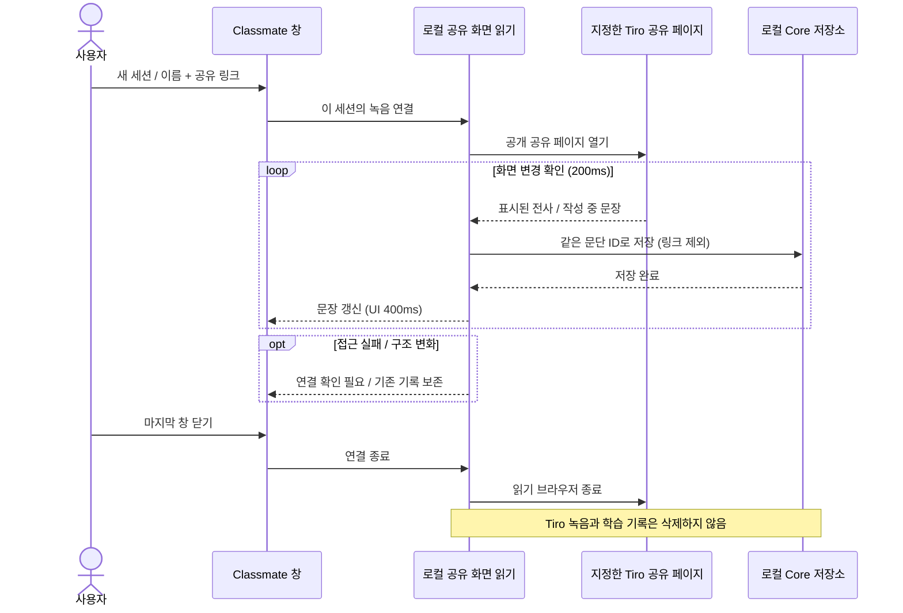
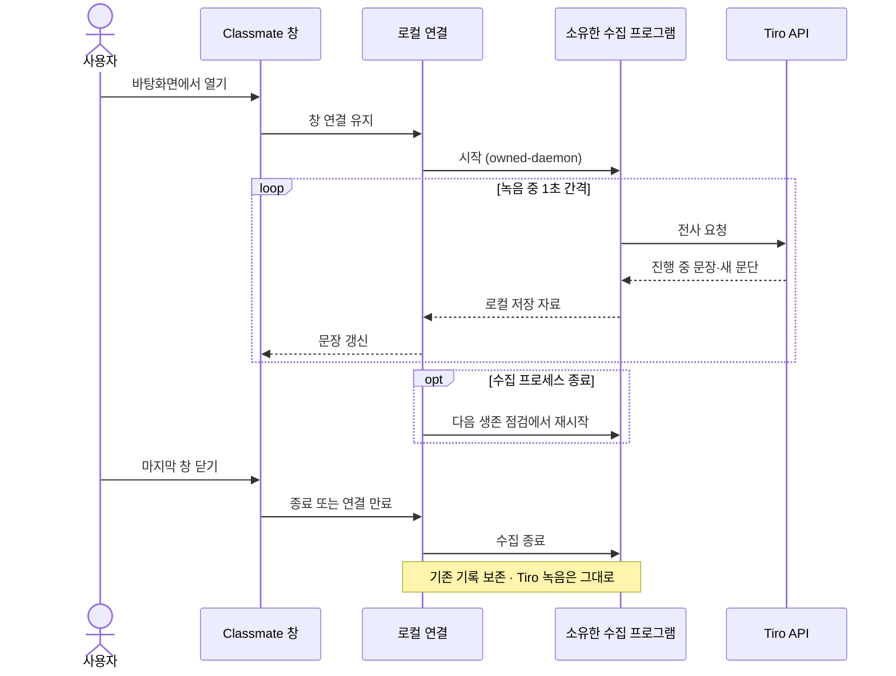
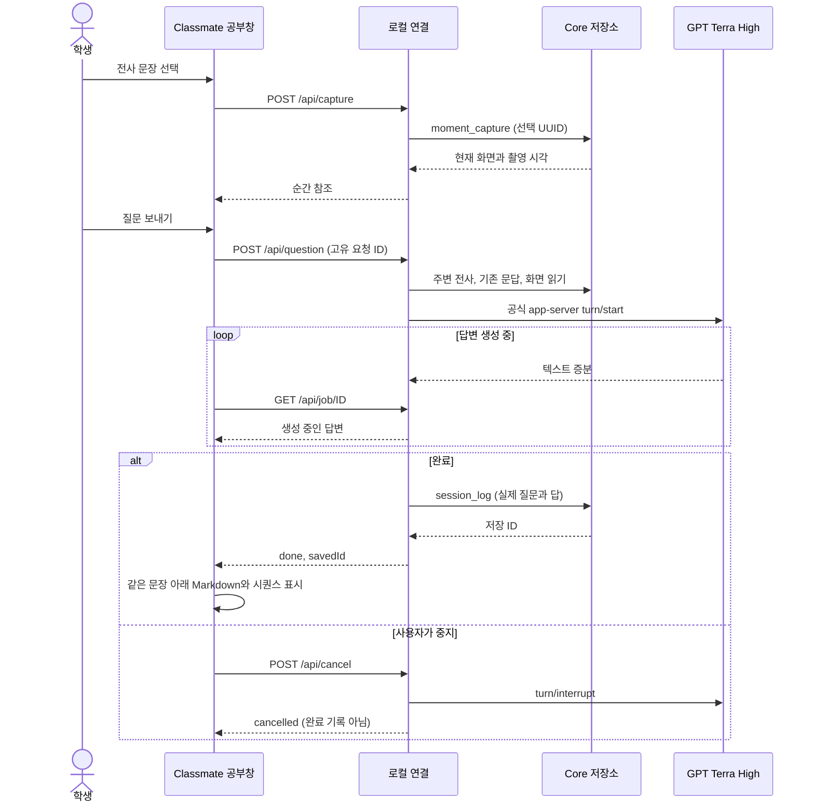

# Local study API · 0.3.0 preview

2026-09-11. Internal loopback contract, not a public network API. Compatible with the existing Core MCP record schemas.

## Per-session share source · latest override

User approved: supply a Tiro share URL per session, instead of guessing the active account note. `POST /api/studies` accepts `name` and optional `url`; no URL creates mode `none` (chat only). Existing legacy studies retain mode `api`. `POST /api/studies/source` accepts `{id,url}` and returns the selected study snapshot, activating its collection; 400 invalid URL/missing study/different recording, 409 busy, 401/403 authorization failure. A different recording needs a new session; reconnecting the same canonical URL is idempotent and restarts its reader. Reading history alone does not change the collection target.

URL allowlist: HTTPS, exactly tiro.ooo, no credentials/custom port, `/s/<id>` or locale-prefixed equivalent; remove query and fragment. Store URL only in local studies.sqlite, return only through the authenticated local UI. Never send URL to Core, tutor, logs, screenshots or Git. Anonymous isolated browser reads only visible public transcript DOM (same selector family as the old extension), no private API/token/cookie extraction, login or paywall bypass. Downloads and popup windows are disabled. Navigation outside the configured share page is rejected. Selector/access failures preserve stored text and expose reconnect guidance.

The desktop alone uses private JSON-RPC `classmate/ingestShare`, enabled with `--owned-daemon` or test-only `--desktop-no-daemon`, denied to ordinary MCP clients and absent from tools/list. Input `{source_id,paragraphs:[{uuid,text,observed_from,observed_to}]}`: deny unknown fields, share-prefixed bounded local IDs, 1..50 rows, text 1..12000 characters, valid ordered RFC3339 timestamps; existing rows must have the same source owner. Desktop sends <=10 rows per batch under the 1MiB transport cap. Output `{ok,inserted,updated}`; JSON-RPC -32602 invalid input, -32601 unsupported mode. Idempotent upsert allows retry; it cannot execute anything or overwrite API UUIDs. New URL authority is not given to GPT.

Share paragraphs preserve `sourceIndex`, `source:'tiro-share'`, `timeBasis:'observed'` in the local index. DOM lacks spoken timestamps; first/last observed time is displayed as **수신**, and tutor context explicitly distinguishes it from speech/video time. The `locked` API flag means paywall masking, never completion. Reduced DOM count is not accepted as a deletion/reorder: retain history and report error. A future DOM restructuring needs a connector update; no promise of permanent selector compatibility.

`GET /api/window?id=<local-window-id>` is an authenticated long-lived event stream with heartbeat comments only (no lecture data). Connection close releases the lease, reliable even when pagehide is lost; multiple windows retain separate leases. No authentication token appears in the request URL. `/api/presence` remains the compatible heartbeat/fallback. Only the app-owned reader/Core/tutor close; no global startup service is registered.

Backward compatible Core snapshot field `paragraphReceivedAt` distinguishes actual API receipt from source time. A one-time index repair takes an exact SQLite backup before moving mistakenly imported pre-session rows and linked answers into an inactive **이전 기록** session. No Core or lesson content is deleted. Thereafter pre-session records cannot silently become new session content.

## Collection lifecycle and delivery repair · 2026-09-11

`POST /api/presence` requires the same loopback origin/token as every write. Input `{id: UUID, open: boolean}`, output `{ok:true}`; 400 invalid input, 401/403 unauthorized. No new external authority. Each app window owns a lease; reload grace is 8 seconds, missing-heartbeat fallback 180 seconds. The launcher closes the service on dedicated Edge process exit or when no live window remains. Only its owned collector/tutor are terminated, not Tiro or another client's collector.

CoreStatus adds optional `lastTiroSuccessAt` (successful upstream completion), `lastTranscriptReceivedAt` (materially changed transcript receipt), and `collectionPaused`. Existing `lastPollAt` remains attempt-start time. `delivery.lastCheckedAt` is only a local snapshot-read time and must not imply live upstream health. Errors retain existing displayed records and set `delivery.refreshError`; a new bridge is retried without replaying an uncertain capture/session_log. Legacy default polling config (3000/5000/30000) migrates to (1000/5000/5000); custom values remain.

## Sequence

## Transport and authority

Bind only 127.0.0.1, ephemeral port. Exact Host and optional Origin matching. Every API requires
`x-classmate-key` equal to a random 256-bit per-process capability. Capability is delivered in the launcher
URL fragment (not a request URL), never printed. POST requires JSON, body <=24,000 JS characters.
No arbitrary file, proxy, command, or RPC endpoint. No CORS wildcard. Unknown endpoints return 404.
Model tools are disabled; child approval requests are rejected, never automatically approved.
Local user control of processes/profile is outside this local CSRF boundary.

| Method / path | Input | Success | Failure |
|---|---|---|---|
| GET /api/status | none | loggedIn, model, effort, aiError | 401/403/500 |
| GET /api/study?id=... | optional study ID, default collecting study | Core status + studyId/activeStudyId/studies, that study's accumulated paragraphs/recentQa, delivery lastCheckedAt/lastChangedAt | 401/403/500 |
| POST /api/studies | name, 1..100 chars | 201 study snapshot; previous study preserved | 400 invalid, 409 busy, 500 |
| POST /api/studies/edit | id, action: rename/trash/restore, name for rename | snapshot; reversible trash, never deletes Core data | 400 invalid/missing, 409 busy, 500 |
| GET /api/preferences | none | transcript, answer, height | 401/403/500 |
| POST /api/preferences | transcript 14..28, answer 14..28, height 30..90 | {ok:true}, local profile persistence | 400/500 |
| POST /api/capture | paragraph_uuid | moment_id, captured_at | 400/500 |
| POST /api/question | id, question, optional study_id (defaults active), optional paragraph_uuid/moment_id | 202 {id}; duplicate id returns 200 without reissuing | 400 invalid, 409 busy, 503 unauthenticated |
| GET /api/job/:id | ID from question | question, paragraphUuid, answer, state, optional savedId/error | 404 |
| POST /api/cancel | id | {ok:true}, idempotent | 400/500 |

Question <=8,000 chars. IDs limited to safe bounded strings. A supplied paragraph must exist in the requested study snapshot.
With no paragraph, use the last 3 lesson paragraphs and last 8 free-chat QAs in that study, no image.
The chosen study belongs to the request, not a global view selection; completion is mapped to that same study.
The collecting study is independent from viewing an older study. New study does not start/stop Tiro or move Core data.
The local studies.sqlite index imports the first Core snapshot (up to 200 paragraphs/100 QAs), then accumulates received
paragraphs while this service runs in legacy API mode. Seen API UUIDs stay assigned to their original study even when updated; share rows have explicit session ownership. Historical Core
records beyond the initial snapshot remain in Core, not automatically imported. Deletion moves only the study index
to a reversible trash state. Trashing the collecting study atomically creates an empty replacement so collection never
targets a deleted study. Restore preserves paragraphs/QAs without taking over the current collector. No permanent-delete endpoint exists.
The supplied paragraph text/capture timestamp is not trusted: server rereads records. Moment must match the paragraph
before attaching its image. Completion only is stored. Job states: preparing -> streaming -> done / unsaved / error / cancelled.
Cancelled partial text is not a completed QA record. `unsaved` explicitly warns the user; no false saved label.
Only one active question per local server; duplicate submission ID is idempotent for that process lifetime.
Finished jobs expire from process memory after one hour; QA database records do not expire through this API.
Generated answer rendering uses Markdown tokens -> React and sanitized strict Mermaid SVG. No model HTML, external media, or diagram actions.

## Acceptance evidence

`smoke.mjs`: isolated real Core SQLite, authenticated loopback HTTP, actual Chromium, fake tutor by default.
`--real-ai`: same test with Terra High, synthetic transcript only (capture requests blocked by test route).
Checks: auth/Origin/unknown route, inline question, incremental answer, Core save, SVG, independent font settings,
cancel without completed record, reload persistence, 430px no page overflow, separate free chat, new study, history isolation,
new transcript delivery and preferences/study restoration across a real service restart, rename/trash/restore, pointer drag,
keyboard split resizing, saved split after restart, and narrow streaming stop-button layout. API key authentication is not accepted.
`probe.mjs --real-ai --entry ...`: synthetic text-only first-token/total-time measurement, no study data.
