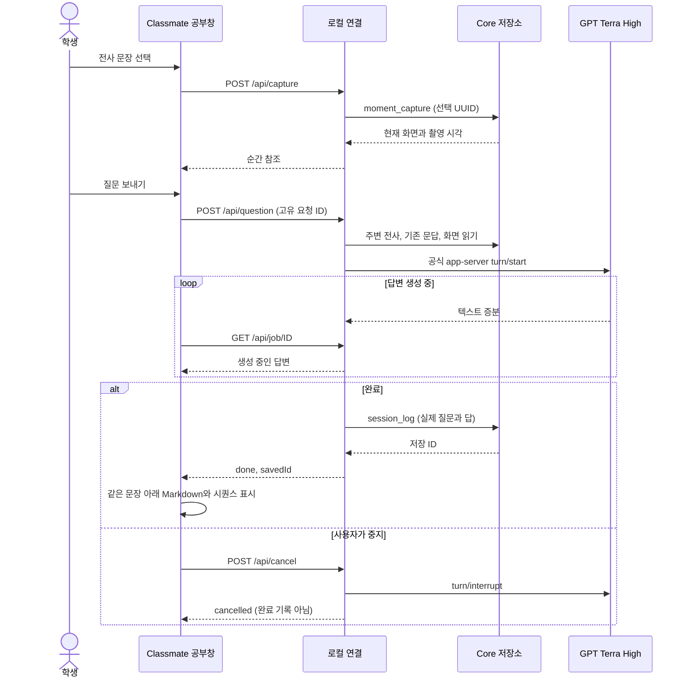

# Local study API · 0.3.0 preview

2026-09-11. Internal loopback contract, not a public network API. Compatible with the existing Core MCP record schemas.

## Sequence

## Transport and authority

Bind only 127.0.0.1, ephemeral port. Exact Host and optional Origin matching. Every API requires
`x-classmate-key` equal to a random 256-bit per-process capability. Capability is delivered in the launcher
URL fragment (not a request URL), never printed. POST requires JSON, body <=24,000 JS characters.
No arbitrary file, proxy, command, or RPC endpoint. No CORS wildcard. Unknown endpoints return 404.
Model tools are disabled; child approval requests are rejected, never automatically approved.
Local user control of processes/profile is outside this local CSRF boundary.

| Method / path | Input | Success | Failure |
|---|---|---|---|
| GET /api/status | none | loggedIn, model, effort, aiError | 401/403/500 |
| GET /api/study?id=... | optional study ID, default collecting study | Core status + studyId/activeStudyId/studies, that study's accumulated paragraphs/recentQa, delivery lastCheckedAt/lastChangedAt | 401/403/500 |
| POST /api/studies | name, 1..100 chars | 201 study snapshot; previous study preserved | 400 invalid, 409 busy, 500 |
| POST /api/studies/edit | id, action: rename/trash/restore, name for rename | snapshot; reversible trash, never deletes Core data | 400 invalid/missing, 409 busy, 500 |
| GET /api/preferences | none | transcript, answer, height | 401/403/500 |
| POST /api/preferences | transcript 14..28, answer 14..28, height 30..90 | {ok:true}, local profile persistence | 400/500 |
| POST /api/capture | paragraph_uuid | moment_id, captured_at | 400/500 |
| POST /api/question | id, question, optional study_id (defaults active), optional paragraph_uuid/moment_id | 202 {id}; duplicate id returns 200 without reissuing | 400 invalid, 409 busy, 503 unauthenticated |
| GET /api/job/:id | ID from question | question, paragraphUuid, answer, state, optional savedId/error | 404 |
| POST /api/cancel | id | {ok:true}, idempotent | 400/500 |

Question <=8,000 chars. IDs limited to safe bounded strings. A supplied paragraph must exist in the requested study snapshot.
With no paragraph, use the last 3 lesson paragraphs and last 8 free-chat QAs in that study, no image.
The chosen study belongs to the request, not a global view selection; completion is mapped to that same study.
The collecting study is independent from viewing an older study. New study does not start/stop Tiro or move Core data.
The local studies.sqlite index imports the first Core snapshot (up to 200 paragraphs/100 QAs), then accumulates received
paragraphs while this service runs. Seen UUIDs stay assigned to their original study even when updated. Historical Core
records beyond the initial snapshot remain in Core, not automatically imported. Deletion moves only the study index
to a reversible trash state. Trashing the collecting study atomically creates an empty replacement so collection never
targets a deleted study. Restore preserves paragraphs/QAs without taking over the current collector. No permanent-delete endpoint exists.
The supplied paragraph text/capture timestamp is not trusted: server rereads records. Moment must match the paragraph
before attaching its image. Completion only is stored. Job states: preparing -> streaming -> done / unsaved / error / cancelled.
Cancelled partial text is not a completed QA record. `unsaved` explicitly warns the user; no false saved label.
Only one active question per local server; duplicate submission ID is idempotent for that process lifetime.
Finished jobs expire from process memory after one hour; QA database records do not expire through this API.
Generated answer rendering uses Markdown tokens -> React and sanitized strict Mermaid SVG. No model HTML, external media, or diagram actions.

## Acceptance evidence

`smoke.mjs`: isolated real Core SQLite, authenticated loopback HTTP, actual Chromium, fake tutor by default.
`--real-ai`: same test with Terra High, synthetic transcript only (capture requests blocked by test route).
Checks: auth/Origin/unknown route, inline question, incremental answer, Core save, SVG, independent font settings,
cancel without completed record, reload persistence, 430px no page overflow, separate free chat, new study, history isolation,
new transcript delivery and preferences/study restoration across a real service restart, rename/trash/restore, pointer drag,
keyboard split resizing, saved split after restart, and narrow streaming stop-button layout. API key authentication is not accepted.
`probe.mjs --real-ai --entry ...`: synthetic text-only first-token/total-time measurement, no study data.
