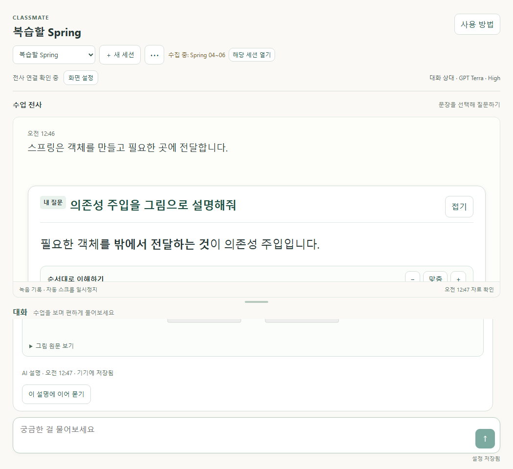

# Classmate 공부창 · GPT Terra / High

전사, 질문, 답변, 그림을 **한 창에서** 보는 Windows용 새 세션 화면입니다.
Chrome 확장 0.1.6과는 별개입니다. 기존 확장과 학습 기록은 삭제하거나 교체하지 않습니다.

## 동희님 PC에서 쓰기

1. 바탕화면의 **Classmate 공부 시작**을 더블클릭합니다. Codex 공부방 대신 Classmate 전용 창이 열립니다.
2. Chrome에서 강의 영상을 보면서 Tiro 녹음을 켭니다. 폰 Tiro 녹음도 같은 계정의 노트라면 가능합니다.
3. 궁금한 **전사 문장을 누릅니다. 그 문장 바로 아래에서 질문**합니다.
4. 답변은 그 자리에서 생성되는 대로 보입니다. `이 설명에 이어 묻기`는 연결된 화면을 다시 사용합니다.
5. `시퀀스 그림으로 설명해줘`를 누르거나 직접 요청합니다. 완성된 Mermaid는 그림으로 표시되며 확대·축소·맞춤과 원문 보기가 가능합니다.
6. 문장을 잘못 눌렀으면 `취소 · Esc`, 이미 질문했다면 `답변 중지`를 누릅니다. 서로 다른 동작입니다.
7. `화면 설정`에서 전사 글씨, 답변 글씨, 학습 영역 높이를 각각 조절합니다.
8. 문장을 선택하지 않아도 **화면 아래 ‘대화’**에서 질문할 수 있습니다. 문장 아래 질문과 별도의 대화이며, 답변과 이어지는 질문도 아래에 쌓입니다.
9. **＋ 새 세션**에서 `Spring 04~06`처럼 원하는 이름을 정합니다. 이후 처음 도착하는 전사부터 새 세션에 모입니다. 기존 기록은 지우지 않으며, 위의 세션 목록으로 다시 열 수 있습니다.
10. 세션 목록 옆 **⋯**에서 **이름 변경·삭제·휴지통**을 사용합니다. 삭제 확인 후 휴지통으로 이동하며 **복원**할 수 있습니다. Tiro 원본·Core 원본은 삭제하지 않습니다. 수집 중인 세션을 삭제하면 이후 전사를 받을 빈 세션이 생성됩니다.
11. 전사와 대화 사이의 **가운데 손잡이를 위아래로 드래그**해 비율을 바꿉니다. 키보드 방향키도 사용할 수 있고, 두 번 클릭하면 기본 비율로 돌아갑니다. 글씨 크기와 비율은 자동 저장되며 아래에 **설정 저장됨**이 표시됩니다.

**Tiro에서 새 녹음을 켜도 Classmate 세션이 자동으로 분리되지는 않습니다.** 여러 녹음을 한 묶음으로 공부할 수 있도록 현재 수집 중인 세션에 이어집니다. 분리하려면 Classmate에서 새 세션을 시작하세요. 이전 세션을 열었을 때는 수집 대상 이름과 이동 버튼을 따로 표시합니다.

새 세션는 Tiro의 새 녹음을 만드는 버튼이 아닙니다. 이미 도착한 문단의 후속 수정은 원래 공부에 남고,
새 문단부터 새 세션에 저장합니다. 이전 세션를 보는 동안에도 새 전사는 현재 수집 중인 공부에 들어갑니다.
처음 전환할 때 기존 Core에서 제공하는 최근 200문단·100문답을 이전 세션로 가져오며, 더 오래된 Core 원본은 삭제하지 않습니다.
새 세션창을 실행한 이후 모은 전사·문답은 별도 공부 색인에 누적되어, 최근 목록에서 밀려나도 다시 열 수 있습니다.

폴더를 고르거나, Codex 채팅에 긴 JSON을 붙이거나, Alt+S를 외울 필요가 없습니다.
질문을 다른 AI 채팅으로 보내지 않으므로 그 채팅의 후속 프롬프트 확인창도 사용하지 않습니다.
이것은 호스트의 보안 확인창을 끄거나 우회한 것이 아니라 **우리 앱의 직접 질문 경로**입니다.



위 화면은 개인정보 없는 합성 수업으로 실행한 실제 UI입니다. 2026-09-11 검증에서는
가짜 AI뿐 아니라 실제 Terra High 답변을 받아 저장·렌더링했습니다. 사용자 수업 원문을 공개한 화면이 아닙니다.

## 답변에 어떤 자료를 주나요?

- 실제 입력한 질문과 선택한 문장.
- 선택 문장 주변의 앞 2개·뒤 1개 문단(현재 도착해 있는 자료만).
- 같은 문장에서 이어진 최근 문답 최대 6개, 다른 문장의 최근 문답 최대 2개.
- 문장을 눌렀을 때 Core가 캡처한 화면 1장. 이어 묻기는 기존 답변에 연결된 화면을 사용합니다.
- 문단 시각과 화면 촬영 시각을 별도로 전달합니다. 과거 문단을 눌렀다고 과거 영상 화면을 복원한 것은 아닙니다.

아래 **자유 대화**에서는 선택 문장을 강제로 붙이지 않습니다. 열어 둔 공부의 최근 전사 3개와 자유 대화 최근 8개를 참고합니다.
화면은 자동 첨부하지 않으므로 화면에 관해 묻고 싶으면 전사 문장을 선택해 질문하세요. 다른 공부의 대화를 섞지 않습니다.

자료는 길이 상한을 적용해 필요한 일부만 보냅니다. 질문 입력은 **8,000자**까지이며,
과거의 ‘답변 40자 제한’은 없습니다. 모델 출력 한도와 3분 답변 대기 제한은 별개입니다.
튜터에게 셸·파일 쓰기·외부 앱 도구를 주지 않고, 앱이 자료 조회와 완료 답변 저장을 담당합니다.
AI가 임의로 만든 질문을 기록하지 않습니다. 취소한 부분 답변은 완료 답변으로 저장하지 않습니다.

**로컬 보관 / 선택한 AI 제공자로 전송될 수 있음 / Corthex 서버 기본 전송 없음**

## 로그인과 모델

- **gpt-5.6-terra / high 고정**입니다. 다른 모델이나 API 키 결제로 자동 전환하지 않습니다.
- 이 PC에 설치된 공식 Codex CLI의 **본인 ChatGPT 로그인**을 사용합니다. 다른 사람의 계정이나 다른 PC의 로그인을 찾는 기능이 아닙니다.
- 설치·로그인이 없는 새 PC에서는 먼저 공식 Codex를 설치하고 `codex login`을 완료해야 합니다. 현재 시작 화면은 로그인 실패를 표시하지만, 최초 로그인 버튼까지 내장한 배포 설치기는 아직 아닙니다.
- Classmate가 인증 파일을 복사하거나 읽어 로그인 토큰을 재사용하지 않습니다. 공식 app-server의 계정 확인을 사용합니다.
- **웹 검색은 이 버전에 연결하지 않았습니다.** 법령·세법·시험 기준·최신 버전은 반드시 해당 시점의 공식 자료로 확인해야 합니다. 답변이 자동으로 최신 검증되었다고 표시하지 않습니다.

## 무엇이 실시간인가요?

Tiro가 문단을 반환하면 Core가 3~5초 간격으로 수집하고 새 세션창은 1초 간격으로 로컬 자료를 읽습니다.
Tiro의 문단 생성 자체가 늦으면 화면에서 더 빨리 만들어 낼 수는 없습니다. 음성의 매 글자가 곧바로 표시되는 STT 엔진은 아닙니다.
답변은 Codex의 텍스트 증분을 받고 UI가 250ms 간격으로 표시합니다. 그림은 완성된 답변에서 렌더링합니다.
합성 짧은 질문 시험의 첫 출력은 약 4.4~5.2초였지만, 모든 질문·화면·계정에서의 속도 보장은 아닙니다.

## 창을 닫았다가 다시 열기

바로가기를 다시 누르면 실행 중인 로컬 연결을 재사용합니다. 완료 문답은 기존 Core SQLite에 남습니다.
세션 이름·문단별 소속·대화 사본은 `study-desktop/studies.sqlite`, 글씨 설정은 `reading-preferences.json`에 저장되어 연결 재시작 후에도 유지됩니다.
창을 닫는다고 진행 중인 Tiro 녹음이나 공용 Core 수집 도우미를 종료하지 않습니다.
화면 수집을 멈추려면 Windows 알림 영역의 Classmate Core 메뉴에서 연속 캡처를 끄거나 종료하세요.
예전 Codex 공부방 바로가기는 바탕화면에 `Classmate 이전 세션방 날짜-시각` 이름으로 보존합니다.

## 개발·검증

Windows, Node 24 이상, Microsoft Edge, 공식 Codex CLI, 빌드된 Core가 필요합니다.
설정은 `%LOCALAPPDATA%/CorthexClassmate/study-desktop`, 학습 정본은 기존 `core`에 둡니다.
HTTP는 임의 포트의 `127.0.0.1`에만 바인딩합니다. 포트 공개·서버 업로드를 하지 않습니다.

```powershell
pnpm install --frozen-lockfile
pnpm --filter @classmate/study-panel build
cargo build --release --manifest-path apps/core/Cargo.toml
node apps/study-desktop/smoke.mjs
# 다음 시험만 실제 ChatGPT 사용량을 소량 사용합니다. 합성 전사만 전송합니다.
node apps/study-desktop/smoke.mjs --real-ai
& ./apps/study-desktop/install-shortcut.ps1
```

공식 app-server 0.153.4에서 확인한 개발 후보입니다. 프로토콜·버전 호환성, 새 PC 설치와 장시간 사용을
아직 모든 환경에서 검증하지 않았으므로 공개 안정 배포판 0.1.6을 자동 교체하지 않습니다.
공개 설치 ZIP에 포함하려면 Node/Codex 설치·로그인 안내, 서명/라이선스, 깨끗한 Windows 설치 검증을 추가로 마쳐야 합니다.

공식 근거: [Codex app-server](https://learn.chatgpt.com/docs/app-server),
[Codex 설정 계약](https://learn.chatgpt.com/docs/config-schema.json),
[Tiro 문단 데이터 모델](https://docs.tiro.ooo/en/developers/fundamentals/note-data-model),
[Tiro API 제한](https://docs.tiro.ooo/en/developers/fundamentals/api-overview),
[Mermaid 안전한 사용](https://mermaid.js.org/config/usage.html).
